<h3><code>johnaqu1no@github ~ $ ./contributions.sh</code></h3>

  

<h3><code>johnaqu1no@github ~ $ whoami</code></h3>

<table>
<tr>
<td valign="top"></td>
<td valign="top"></td>
</tr>
</table>

Hand-rolled animated SVGs, regenerated daily by <a href=".github/workflows/update-profile-art.yml">a workflow</a>.

